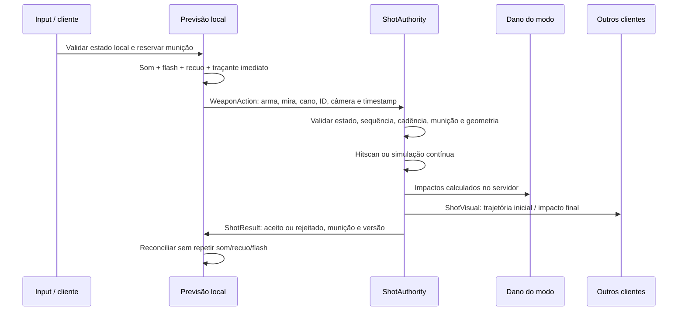

# Crossgrounds — reformulação dos disparos

**23/10/2026. Aplicado ao projeto aberto no Studio, sem publicação.**

O [diagnóstico inicial](DISPAROS-DIAGNOSTICO.md) foi escrito antes das alterações. Foram preservados modelos, controles, menus, mapas, melee, dano nominal, headshots, queda por distância, recompensas e regras de CTF/Arena. Nenhuma arma nova foi criada. Todas as armas existentes continuam **hitscan**.

## Diagnóstico

O sistema já tinha raycast autoritativo e feedback local antecipado. Não havia balas físicas nem dependência de `Touched` para dano de armas de fogo; os usos de `Touched` encontrados eram das bandeiras. A correção aproveitou essa base.

Os problemas principais eram dispersão diferente entre previsão/CTF/Arena, ausência de confirmação de rejeições, IDs sem controle de repetição, munição dependente somente da replicação, previsão sem todas as regras de penetração e traçantes estáticos descartáveis. A cadência automática acumulava atraso de frames. Recargas também podiam terminar com um personagem obsoleto.

Durante os testes, surgiu evidência para compensação de latência: com atraso de 150 ms em cada direção e jitter de 20 ms, o alvo móvel chegou a apresentar diferença de **4,88 studs** entre a linha enviada e sua posição atual no servidor. Houve **3 acertos entre 9 disparos aceitos** no teste anterior ao histórico. Depois da compensação, uma nova amostra de **6 disparos aceitos teve 6 acertos**. As amostras têm durações e fases de movimento diferentes; não constituem um benchmark competitivo.

## Arquivos e responsabilidades

Caminhos abaixo relativos a `src/`; as instâncias correspondem à mesma hierarquia no Studio.

| Arquivo | Responsabilidade |
|---|---|
| ReplicatedStorage/KitDefinitions.luau | Tipo de disparo e configuração visual das armas existentes; preserva números de combate |
| ReplicatedStorage/Crossgrounds/ShotMath.luau | Vetores finitos, configuração e dispersão determinística por seed da arma/ID/pellet |
| ReplicatedStorage/Crossgrounds/ShotQuery.luau | Raycast/Spherecast compartilhados, aliados/corpos, penetração e origem limitada do cano |
| ReplicatedStorage/Crossgrounds/ProjectileSimulation.luau | Projétil lógico, integração por deltaTime e varredura contínua |
| ReplicatedStorage/Crossgrounds/ShotLedger.luau | Sequência, orçamento de eventos e cadência sem acumular tolerância |
| ReplicatedStorage/Crossgrounds/ShotPrediction.luau | Reservas locais de munição e reconciliação por versão |
| ReplicatedStorage/Crossgrounds/ShotCosmetics.luau | Pool limitado de traçantes, deslocamento visual, correção e limpeza |
| ReplicatedStorage/Crossgrounds/WeaponEffects.luau | Preserva flash e áudio independente; delega traçantes ao componente cosmético |
| ServerScriptService/Crossgrounds/Ballistics.luau | Fachada de compatibilidade para o módulo de consultas compartilhado |
| ServerScriptService/Crossgrounds/ShotAuthority.luau | Validação, consumo de munição, resolução autoritativa e agendamento de projéteis |
| ServerScriptService/Crossgrounds/ShotHistory.luau | Histórico limitado de hitboxes e interseções sem mover personagens reais |
| ServerScriptService/Crossgrounds/ShotEffects.luau | Replicação inicial/final de efeitos, sem posições por frame |
| ServerScriptService/Crossgrounds/ArenaCombat.luau | Mantém validação de modo, dano/proteção/recompensas da Arena; delega disparos |
| ServerScriptService/MainGameScript/GameManager/KitService.luau | Mantém kits, treino e dano CTF; delega disparos e protege conclusão de recarga |
| ServerScriptService/MainGameScript/GameManager/WeaponFactory.luau | Seed atribuída pelo servidor e versão inicial de munição |
| ServerScriptService/MainGameScript/GameManager/BotBrain.luau | Mantém comportamento dos bots; usa dispersão compartilhada nos hitscans existentes |
| StarterPlayer/StarterPlayerScripts/WeaponController.luau | Feedback antecipado, reserva de munição, requisição e confirmação; agenda automática sem rajada de recuperação |
| StarterPlayer/StarterPlayerScripts/CombatPresentation.luau | Mira/cano, previsão, correção e supressão de efeitos duplicados/atrasados |
| StarterPlayer/StarterPlayerScripts/CombatHUD.luau | Exibe munição prevista enquanto aguarda o servidor |
| ServerStorage/UnitTest/Cases/ShotPipeline_Test.luau | 11 testes de contratos, deltaTime, varredura, volume, munição e protocolo |
| ServerStorage/UnitTest/Cases/ShotHistory_Test.luau | 6 testes de janela, hitboxes, paredes, proteção, penetração, morte e teleporte |

## Fluxo de um disparo

O servidor não recebe dano ou alvo escolhido como autoridade. Recalcula a trajetória a partir de uma intenção de câmera limitada, verifica o trecho cabeça–câmera e cabeça–cano e respeita os obstáculos atuais. A profundidade enviada precisa pertencer ao raio da câmera; ela não dispensa os raycasts. A tolerância de distância da câmera considera deslocamento limitado durante a latência, chegando no máximo a 18 studs. A origem de primeira pessoa continua limitada e sujeita a obstrução.

`ShotResult` é criado pelo servidor, assim como os remotes anteriores. Tiros inválidos de jogadores mortos, armas desequipadas ou modo incorreto são descartados pelos adaptadores. Replays e floods não geram resposta adicional; previsões sem confirmação expiram. Rejeições de estado do disparo, cadência, munição, recarga, timestamp ou vetores retornam correção quando a requisição passa pelo orçamento/sequência.

Cadência admite até 50 ms de variação de chegada, mantendo uma agenda autoritativa: antecipações não se acumulam para aumentar a cadência sustentada. O orçamento é de 20 eventos/s, com capacidade inicial de 32. IDs devem ser inteiros crescentes, com salto máximo de 128; IDs repetidos/anteriores são recusados.

### Hitscan e projéteis simulados

- Hitscan calcula o acerto imediatamente; a velocidade do traçante não altera o instante do dano.
- Simulação é opt-in: velocidade, aceleração e gravidade são integradas com o tempo transcorrido, em subpassos de no máximo 1/120 s. Cada segmento entre posições é consultado; não depende de `Touched`.
- Raio maior que zero usa Spherecast. O início dentro de um BasePart é verificado por sobreposição e ponto de superfície. Terreno, meshes complexas e portas móveis ainda precisam de testes adicionais de volume.
- Há limite de distância, lifetime e alvos; dano por distância e penetração acumulam entre passos. Morte, troca de arma e saída do modo encerram projéteis lógicos ativos.
- O teste de uma configuração temporária de projétil foi realizado apenas durante Play. Ela foi descartada ao parar; nenhum armamento existente foi convertido.

Configuração por arma: `ShotType` (`hitscan`/`projectile`), `Damage`, `Range`, `Cooldown`, `Spread`, `ProjectilesPerShot`, `ProjectileSpeed`, `ProjectileLifetime`, `ProjectileGravity`, `ProjectileAcceleration`, `ProjectileRadius`, `MaxTargets`, `PenetrationLoss` e `ShotVisual` (`Speed`, `Length`, `Width`). Sons/recuo continuam nos campos existentes. Os adaptadores mantêm as regras de cada modo.

### Compensação de latência

O servidor mantém aproximadamente 470 ms de amostras de hitboxes a 30 Hz; **o rewind utilizado nunca passa de 400 ms**. Ping medido pelo servidor determina a faixa permitida do timestamp e uma estimativa limitada do atraso de apresentação. O timestamp recebido não pode escolher livremente um instante do histórico. Pacotes com timestamp mais de 1,5 s distante são rejeitados antes de gastar munição.

A compensação é usada nos hitscans de jogadores com ping medido acima de 40 ms. Sem isso, permanece o raycast convencional. Bots conservam seus hitscans atuais; projéteis com viagem não usam rewind. Alvos mortos não são recuperados, novos personagens usam posição atual se falta histórico e deslocamentos acima de 18 studs não são interpolados para trás. Paredes e portas são consultadas no estado atual.

Hitboxes históricas usam caixas orientadas das partes consultáveis do corpo/acessórios, sem aumentar seu tamanho. Isso pode diferir do detalhe de colisão de meshes. O atraso de renderização é uma estimativa; a janela limitada não resolve todas as condições de jitter, alta latência ou alvos entrando em cobertura. Exige avaliação com jogadores reais antes de ajustar a janela.

## Desempenho e ciclo de vida

- Até 128 linhas cosméticas reutilizáveis, um atualizador compartilhado e desconexão quando o conjunto fica vazio. O limite reduz somente efeitos, nunca dano.
- Teste de 50 traçantes reutilizou cinco instâncias ao todo; terminou com zero ativos e sem conexão aberta. No teste de rajadas com rede, uma instância foi suficiente.
- Projéteis lógicos compartilham uma conexão Heartbeat somente enquanto existem projéteis ativos. Hitscans não criam projéteis físicos nem loops de viagem no servidor.
- Histórico tem um coletor compartilhado a 30 Hz, sem conexão por personagem; remove referências de modelos retirados do mundo.
- Sons preservam emissores independentes para não cortar caudas. Continuam sendo instâncias temporárias, com limpeza por término/Debris; não foi feito benchmark de áudio com servidor lotado.
- Nenhuma posição de bala é replicada por frame. Hitscan envia resolução visual e confirmação; simulação envia lançamento e término, além da confirmação do disparo.

## Validação executada

| Cenário | Resultado observado |
|---|---|
| Suíte completa em Scripts normais no servidor | **116/116 passaram**, incluindo 17 testes novos |
| Fontes de runtime/testes no Studio | 138 compilaram; 21 fontes do patch conferidas com os arquivos locais |
| Preservação e pacote | 117 fontes anteriores fora do patch sem divergência; as 21 fontes exportadas correspondem ao Studio |
| Input pelo roteador com Gamepad simulado | Feedback registrado em cerca de 1,4 ms, antes da confirmação; uma bala consumida e dano CTF de 29 no treino |
| Rede: 150 ms por direção + jitter de 20 ms | Confirmação inicial em cerca de 367 ms; feedback local em cerca de 1,7 ms |
| Rajadas com rede, Gamepad e Touch simulados | 8 tiros aceitos, 8 sons, 8 balas consumidas; sem duplicação observada; erro final de endpoint 0 no alvo parado |
| Alvo móvel sob a rede simulada | Antes: 3/9 acertos aceitos; depois: 6/6 na nova amostra; todos os 6 impactos confirmados |
| Replay, fora de ordem, salto de IDs e flood | Recusados nos testes do ledger; replay pelo Remote não consumiu munição extra |
| Timestamp velho/futuro, NaN, vetor nulo e câmera absurda | Recusados sem consumir munição nos testes autoritativos |
| Munição vazia, recarga, arma desequipada e estado inválido | Recusados pelo servidor sem consumir munição |
| Personagem morto + envio direto pelo Remote | Vida 0; munição permaneceu 11 antes/depois |
| Alcance e parede antes do alvo | Sem dano além do limite/atrás da parede |
| Aliados, acessórios, corpos e sniper | Testes preservam dois alvos, perda de 20%, proteção, queda por distância e headshots |
| Histórico + parede, proteção, morte e teleporte | Casos passaram; parede atual continua bloqueando e proteção interrompe penetração |
| Passos matemáticos de 30/60/120 FPS | Posições equivalentes com tolerância de 0,02 stud, incluindo aceleração |
| 10.000 studs/s, obstáculo fino, dt variável | Varredura detectou o obstáculo, inclusive com passo externo de 1 s |
| Spherecast real com raio 0,5 | Detectou obstáculo fora da linha central; raio 0 passou ao lado |
| Volume iniciado dentro de sólido | Encerrou imediatamente, distância percorrida 0 |
| Projétil temporário a 20.000 studs/s na Arena | Acertou alvo de espessura 0,1; vida 1000 → 955; somente launch/impact; pool voltou ao estado ocioso |
| Arena, tiro normal | Alvo de 20 HP eliminado; arma permaneceu equipada; primeira pessoa mantida |
| Arena, recarga | 12 → 11 → 12 balas, reserva 119; disparo durante recarga suprimido; HUD reconciliou para 12 |

O primeiro teste sintético de histórico tinha um salto instantâneo de posição entre amostras e escolhia um timestamp na interpolação desse salto. Dois casos falharam inicialmente; a fixture foi corrigida para selecionar uma amostra antiga estável. Os seis casos de histórico passaram novamente e, depois, a suíte completa passou 116/116.

Os testes de input usaram LocalScripts normais e `ControlRouter:Dispatch`, não controles físicos. A sessão de rajada mediu aproximadamente 50,5 FPS reais. **Não foram executadas sessões renderizadas limitadas a 30/60/120 FPS**, nem combate entre dois clientes humanos. Erros dos primeiros ensaios ligados a fixtures destruídas foram isolados e não fazem parte das fontes entregues. No fechamento da suíte permaneceram avisos preexistentes de plugin/configuração; não houve falha da suíte.

## Pendências e limites

1. Testar servidor com múltiplos jogadores reais, adversários humanos móveis e observadores vendo os mesmos efeitos.
2. Validar mouse, controle Xbox/PlayStation e multitoque em aparelhos físicos, incluindo tiro durante corrida, mudanças rápidas de câmera e troca de arma.
3. Repetir sessões renderizadas em 30/60/120 FPS, perda de pacotes, jitter mais alto e latência assimétrica. Não há resultado de benchmark para esses casos.
4. Avaliar o rewind em colisões de meshes, animações extremas, portas móveis e entrada em cobertura; a janela de 400 ms é um limite técnico, não uma promessa de justiça em qualquer conexão.
5. Fazer teste de carga de um servidor cheio, principalmente histórico e vozes de áudio simultâneas. Não foi alegado ganho quantitativo de FPS/CPU.
6. Instalação em outro Place não testada. Cliente e servidor devem receber juntos os módulos e o protocolo atualizado.

## Preservação e entrega

Backup de 11 fontes anteriores em **ServerStorage.ShotPipelineBaseline_20261023**. Legado, mapas e pacotes anteriores permanecem preservados. Scripts/fixtures temporários dos testes foram descartados ao encerrar Play. Configurações de rede do Studio foram restauradas a zero, como estavam antes do teste.

Pacote incremental: [crossgrounds-disparos-2026-10-23.rbxm](../artifacts/crossgrounds-disparos-2026-10-23.rbxm), 19 fontes de runtime e 2 casos de teste. Deve ser mesclado por serviço/caminho, substituindo as fontes correspondentes; não duplique controladores nem use o pacote como um Place completo. O Studio aberto já recebeu as alterações. Não há instalador automático ou publicação.

Tamanho: **67.612 bytes**. SHA-256: `32D0D5182FE37400A0C4B4A6CD9AFF4B2EA825217E9601F29D3D96BF40075244`.

## Referências primárias consultadas

- [Raycasting — Roblox](https://create.roblox.com/docs/workspace/raycasting): alcance, resultados e filtros.
- [WorldRoot — Roblox](https://create.roblox.com/docs/reference/engine/classes/WorldRoot): Raycast/Spherecast.
- [BasePart — Roblox](https://create.roblox.com/docs/reference/engine/classes/BasePart): consulta de ponto de superfície para a sobreposição inicial.
- [Network Simulator — Roblox](https://create.roblox.com/docs/studio/network-simulator): atraso/jitter por direção durante playtests.
- [NetworkSettings — Roblox](https://create.roblox.com/docs/reference/engine/classes/NetworkSettings): propriedades usadas no teste e depois restauradas.

Arsenal foi referência de responsividade fornecida pelo usuário; não houve alegação de reproduzir sua implementação interna.
